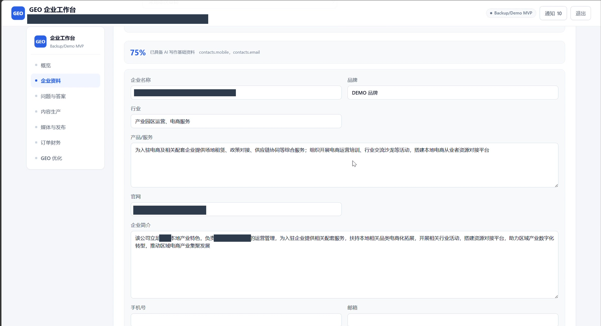
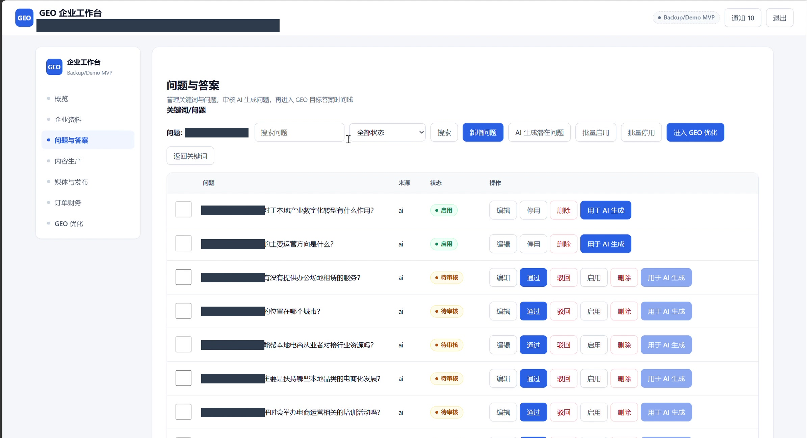
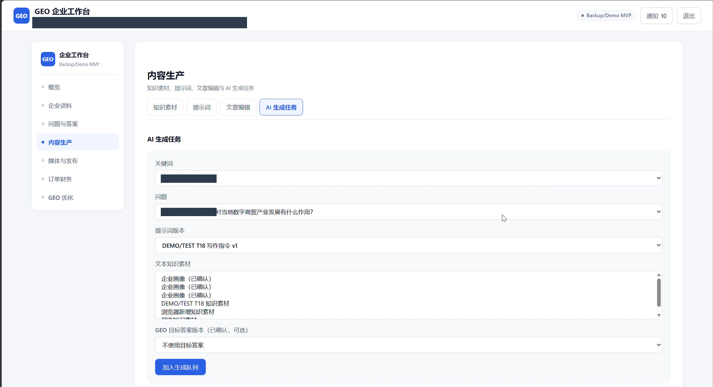
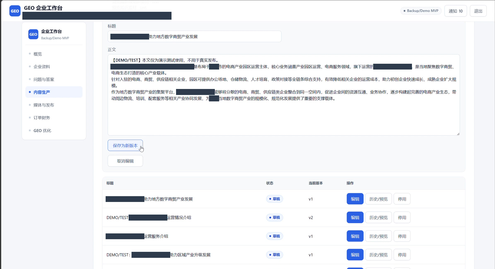
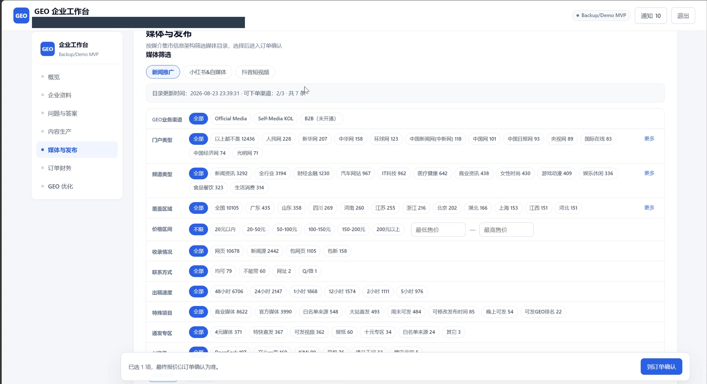
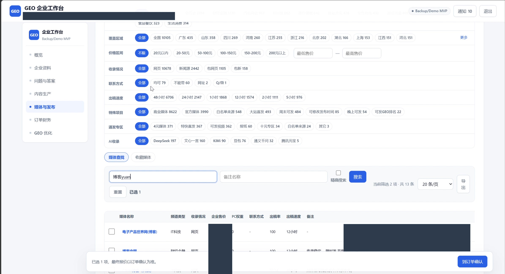
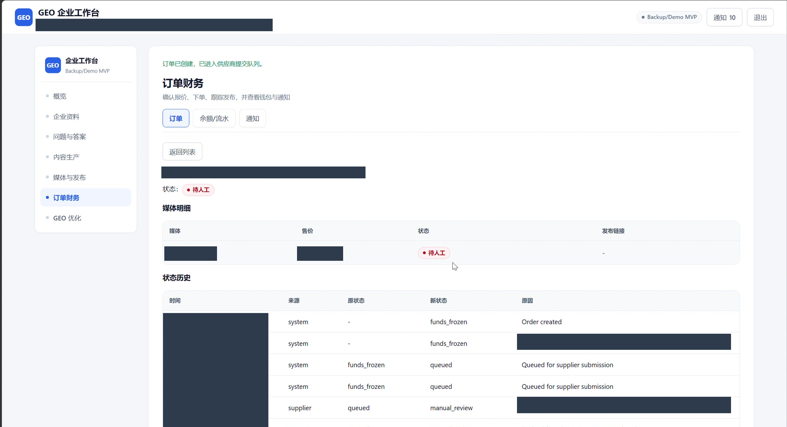
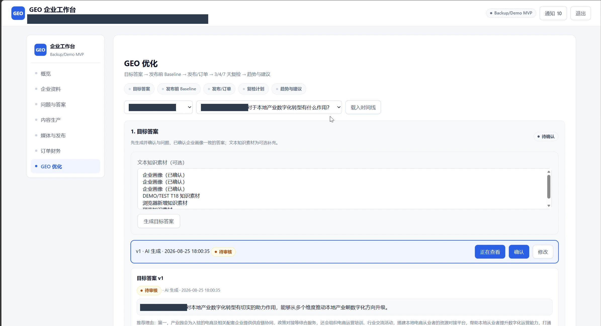

# 项目截图说明

本目录区分原项目历史演示和当前可运行的 Portfolio Mock 演示。

## 原项目历史演示：2026-08-26

来源为项目开发者提供的历史录屏（4 分 46 秒，2416×1440）。以下是单帧裁剪与遮挡，不拼接生成业务结果；时间点为抽样近似值。浏览器标签和地址栏已裁去，敏感身份、账号、网站、订单标识、具体报价及供应商备注已遮挡。

| 画面 | 约时间点 | 可展示内容 |
| --- | --- | --- |
| [企业资料与完整度](original-demo/01-company-profile.jpg) | 01:00 | 企业资料与完整度 |
| [AI 问题库与人工审核](original-demo/02-question-review.jpg) | 01:32 | AI 问题库与人工审核 |
| [知识素材与 AI 生成任务](original-demo/03-ai-task-input.jpg) | 01:56 | 知识素材与 AI 生成任务 |
| [生成后的文章正文与版本列表](original-demo/04-generated-article.jpg) | 02:20 | 生成后的文章正文与版本列表 |
| [多渠道媒体目录与筛选](original-demo/05-media-filters.jpg) | 02:44 | 多渠道媒体目录与筛选 |
| [媒体搜索结果与选择](original-demo/06-media-results.jpg) | 03:24 | 媒体搜索结果与选择 |
| [订单状态与事件历史](original-demo/07-order-status.jpg) | 03:56 | 订单状态与事件历史 |
| [GEO 目标答案与审核](original-demo/08-geo-target-answer.jpg) | 04:12 | GEO 目标答案与审核 |

### 证据边界

- 文章画面展示任务之后已有正文与版本列表；视频本身不能单独证明底层调用的模型或供应商。
- 媒体截图展示当时的目录字段、筛选与搜索结果；不表示现有公开版会连接该目录。
- “AI 收录”属于媒体目录的筛选属性，不能作为本系统已实现联网检测的证据。
- 订单仍为“待人工”，事件历史不等于发布终态；订单编号、金额、事件时间和供应商编号已遮挡。
- GEO 截图为目标答案及待审核状态。录屏结尾显示可见度能力未开通，该画面未作为检测成功成果展示。
- 保留原界面上的 Backup/Demo MVP 与 DEMO/TEST 标签，不据此承诺商业上线、真实客户或增长效果。
- 原视频、原始截帧和 OCR 数据仅用于本地审阅，不属于仓库发布内容。

## 当前 Portfolio Mock 演示

下面保留首版虚构数据截图，来自独立展示环境，便于与本地运行结果对照。它们不是原项目历史业务记录。

- [概览](01-overview.jpg)
- [企业资料](02-company-profile.jpg)
- [问题库](03-questions.jpg)
- [AI 任务状态](04-ai-generation.jpg)
- [文章版本](05-article-versions.jpg)
- [模拟媒体目录](06-media-directory.jpg)
- [模拟发布订单](07-publish-order.jpg)
- [模拟 GEO 时间线](08-geo-timeline.jpg)

## 原项目历史截图预览

### 企业资料与完整度

### AI 问题库与人工审核

### 知识素材与 AI 生成任务

### 生成后的文章正文与版本列表

### 多渠道媒体目录与筛选

### 媒体搜索结果与选择

### 订单状态与事件历史

### GEO 目标答案与审核

